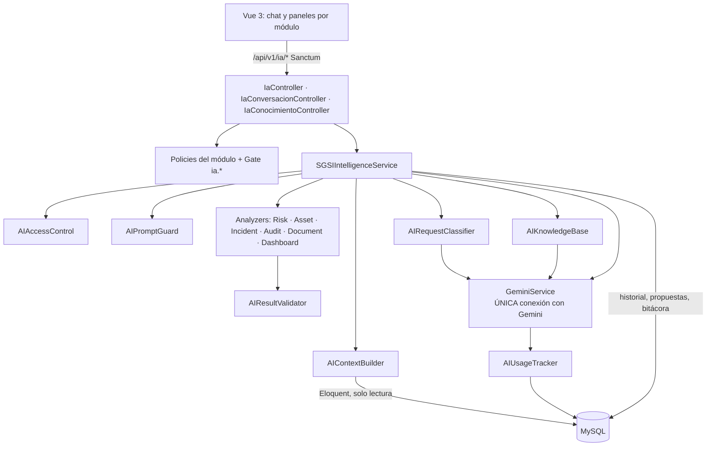
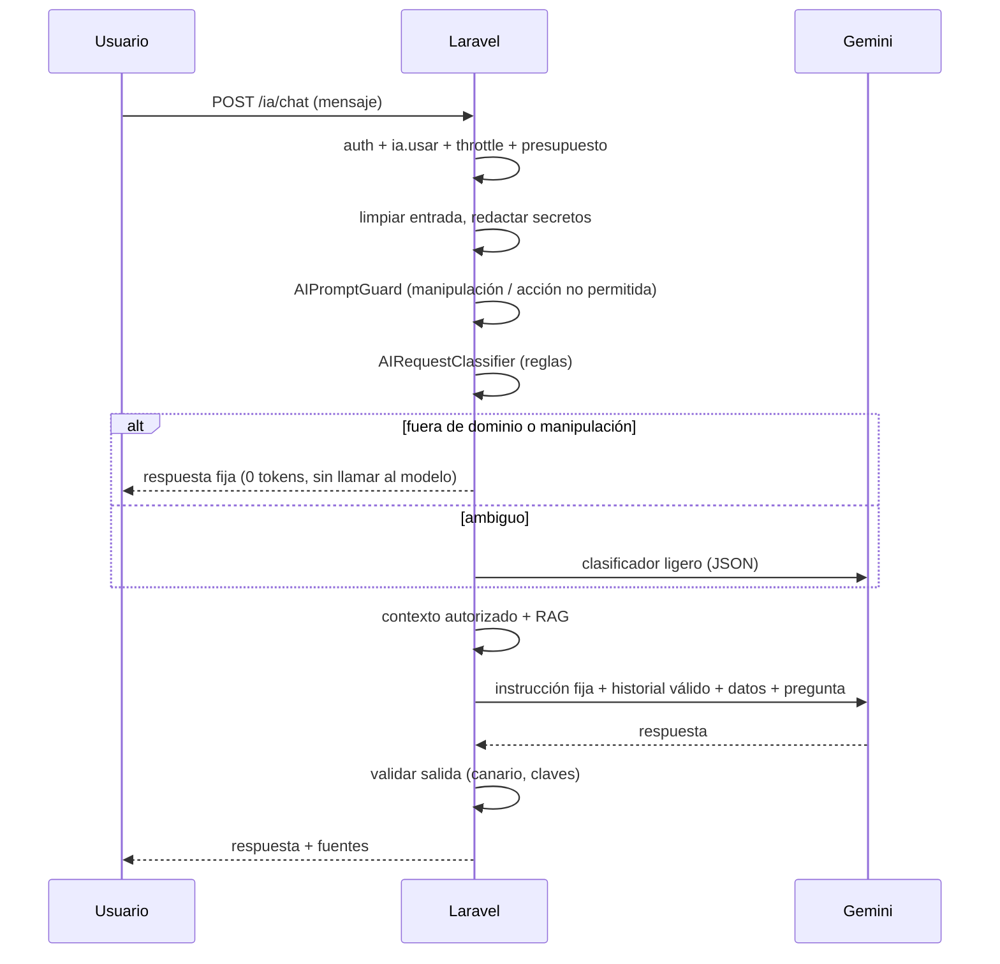

# SGSI Intelligence Assistant

Asistente inteligente especializado de GSI UPTex. Apoya la gestión de seguridad de la información, la asesoría sobre ISO/IEC 27001:2022 y el análisis de los registros de la plataforma. **No es un chatbot de propósito general**: su dominio está restringido en el backend.

- **Nombre visible:** SGSI Intelligence Assistant.
- **Proveedor interno:** Google Gemini. El nombre del proveedor solo aparece en la configuración administrativa.
- **Principio:** la IA recomienda y prepara; Laravel autoriza, valida y ejecuta. Nada se modifica sin la confirmación del usuario.

---

## 1. Integración existente y su evolución

| Antes (V7 original) | Ahora |
|---|---|
| `App\Services\IaRiesgoService` hablaba directo con Gemini. | Se conserva como **fachada** y delega en `AI\Analyzers\AIRiskAnalyzer`. |
| Un solo modelo (`gemini-3.5-flash`); si estaba saturado o sin cuota, la función fallaba. | Modelo principal con **modelos de respaldo** y **cortacircuitos**. |
| Solo controles, probabilidad e impacto. | Además: amenazas, vulnerabilidades, consecuencias, análisis CID, tratamiento, acciones preventivas, riesgo residual y recomendaciones. |
| Sin registro de consumo. | Registro de cada llamada (tokens y latencia) y presupuesto diario. |
| Panel «Asistente de IA» en el formulario de riesgos. | El mismo flujo («Sugerir con IA» → revisar → aplicar), con la identidad SGSI Intelligence Assistant y aplicación selectiva. |

**Se reutilizó** la conexión (endpoint `generateContent`, clave en la cabecera `x-goog-api-key`, `thinkingLevel=low` y reintento ante 503), la validación de controles contra `controles_iso`, el acotado de la escala 1-5, el endpoint `POST /api/v1/ia/sugerir-riesgo` con su contrato de respuesta, el limitador `ia-sugerencias` y la excepción `IA_NO_DISPONIBLE`.

**Causa de que la función no apareciera o no respondiera:** la clave configurada tiene la **cuota agotada** (HTTP 429) para `gemini-3.5-flash`, y ese modelo responde con frecuencia 503 («high demand») o tarda más de 25 s. Como no había un modelo de respaldo, cada intento terminaba en «El servicio de IA no está disponible». Ahora la solicitud continúa con `gemini-3.5-flash-lite` y `gemini-flash-lite-latest`.

---

## 2. Arquitectura



### Componentes (`app/Services/AI/`)

| Componente | Responsabilidad |
|---|---|
| `GeminiService` | Única conexión con Gemini: generación, embeddings, modelos de respaldo, cortacircuitos, presupuesto de tiempo, clasificación de errores y registro de consumo. |
| `GeminiPeticion` / `GeminiRespuesta` | Objetos de petición y respuesta inmutables. |
| `SGSIIntelligenceService` | Orquestador: identidad e instrucción de sistema fijas, chat, pipeline común de análisis y decisiones sobre propuestas. |
| `AIRequestClassifier` | Filtro de dominio previo al modelo principal: reglas locales por intención y clasificador ligero con JSON para lo ambiguo. |
| `AIPromptGuard` | Protección contra prompt injection: entrada, redacción de secretos, fragmentos RAG sospechosos y validación de salida (canario). |
| `AIAccessControl` | Permisos `ia.*` y del módulo, y alcance por departamento (rol Consulta). |
| `AIContextBuilder` | «Herramientas» de consulta controladas: Laravel recupera los datos autorizados; la IA nunca consulta MySQL. |
| `AIKnowledgeBase` | RAG: ingesta, fragmentación, embeddings y búsqueda semántica o por palabras clave. |
| `AIDocumentTextExtractor` | Texto de PDF (vía Gemini), DOCX (ZipArchive), XLSX (PhpSpreadsheet), TXT, MD y CSV. Sin dependencias nuevas. |
| `AIResultValidator` | Validación de la salida: tipos, rangos, catálogos y referencias normativas verificadas. |
| `AIPlatformGuide` | Guía fija del funcionamiento de GSI UPTex, citable como fuente. |
| `AIUsageTracker` | Presupuestos diarios de tokens (por usuario y global) y resumen de consumo. |
| `Analyzers/*` | Un analizador por módulo, todos sobre el pipeline común. |

### Flujo de una pregunta en el chat



---

## 3. Integración por módulo

Todas las integraciones generan **propuestas revisables** (tabla `ia_analisis`). El usuario las **acepta, rechaza o aplica parcialmente**, y cada decisión queda en la bitácora.

| Módulo | Dónde | Qué hace | Acción real al aceptar |
|---|---|---|---|
| Riesgos | Formularios «Registrar riesgo» y «Editar riesgo» | Análisis completo con la metodología del sistema. | Aplica al formulario solo lo marcado: P/I, tratamiento y residual. El usuario guarda. |
| Activos | Formulario «Nuevo activo» y detalle del activo | Clasificación CID, nivel de información, riesgos del catálogo, controles, vulnerabilidades, mejoras y **campos faltantes (cálculo determinista)**. | En el formulario, aplica C/I/D. En el detalle, solo registra la decisión. |
| Incidentes | Detalle del incidente | Naturaleza, categoría, certeza (sospecha, indicio o confirmado), severidad, CID, contención, recuperación, prevención e informe en borrador. | Guarda el informe como **comentario interno** con la API de comentarios. Nunca cambia el estado. |
| Auditorías | Detalle de la auditoría | Resumen, hallazgos y posibles no conformidades con referencia verificada, mejoras, acciones correctivas y recurrencias. | «Usar como hallazgo» precarga el **formulario oficial**; el auditor lo registra. |
| Documentos | Detalle del documento | Resumen, tipo, inconsistencias, faltantes, mejoras, controles, necesidad de actualización y respuesta a una pregunta. | Registra la decisión. El documento nunca se modifica. |
| Dashboard | Panel «Resumen ejecutivo» | Estado general, prioridades enlazadas a módulos visibles, áreas de mejora y datos insuficientes. | Las **cifras vienen de Laravel**, no de la IA. |

### Metodología de riesgos (sin cambios)
- La escala sigue siendo 1-5. El **nivel** siempre lo resuelve `MatrizRiesgoResolver` con la matriz configurada. Si el modelo envía un nivel, se ignora.
- Los valores de la metodología (`ProbabilidadRiesgoCalculator` e `ImpactoRiesgoCalculator`) se envían como referencia y se muestran junto a la propuesta.
- Al guardar, el backend recalcula el nivel como siempre.

---

## 4. Restricción de dominio

**Categorías permitidas:** `SGSI_UPTEX`, `ISO_27001`, `ISO_27002`, `CIBERSEGURIDAD`, `GESTION_ACTIVOS`, `GESTION_RIESGOS`, `GESTION_INCIDENTES`, `AUDITORIAS`, `DOCUMENTACION`, `SEGURIDAD_INFORMACION`, `AYUDA_PLATAFORMA`.

**Categorías de rechazo:** `FUERA_DE_DOMINIO`, `INTENTO_MANIPULACION` y `ACCION_NO_PERMITIDA`.

Las reglas evalúan la **intención**, no solo palabras sueltas:
- **Formato creativo** (poema, cuento, chiste, canción…): se rechaza aunque trate de seguridad.
- **Tema ajeno con contexto de seguridad real:** se permite. «¿Qué controles aplico para que no roben mi cuenta de Instagram?» → `CIBERSEGURIDAD`.
- **Tema ajeno sin contexto de seguridad:** se rechaza. «¿Qué publico para tener más seguidores?»
- **Tecnología general sin seguridad ni relación con la plataforma:** se rechaza. «¿Cómo funcionan las bases de datos?» se rechaza; «¿Qué medidas de seguridad aplico a la BD MySQL de GSI UPTex?» se permite.
- **Ambiguo:** lo decide un clasificador ligero (`GEMINI_CLASSIFIER_MODEL`) con salida JSON. Ante la duda, lo rechaza. Con `IA_CLASIFICADOR_LLM=false`, todo lo ambiguo se rechaza.
- **Saludos** («hola», «¿qué puedes hacer?»): se responden localmente sin consumir tokens.

Las solicitudes rechazadas **no llegan al modelo principal** y reciben la respuesta fija definida por el proyecto.

---

## 5. Seguridad (OWASP Top 10 para aplicaciones LLM)

| Riesgo | Medidas |
|---|---|
| LLM01 Prompt injection | Detección en Laravel antes del modelo. Instrucción de sistema fija en el servidor. Los datos y documentos van entre etiquetas como *información, no instrucciones*. Los mensajes rechazados o bloqueados no vuelven al historial enviado al modelo. Los fragmentos RAG con instrucciones ocultas se excluyen. Se eliminan caracteres invisibles. |
| LLM02 Divulgación de información sensible | Redacción de contraseñas, tokens, claves, JWT y llaves privadas **antes** de enviar o guardar. El contexto no incluye correos, teléfonos ni nombres de personas; las fichas técnicas omiten serie, IP y MAC. Canario en la instrucción de sistema: si aparece en la salida, la respuesta se descarta. |
| LLM05 Manejo inadecuado de la salida | Markdown seguro en el frontend: se escapa todo el HTML y no se generan enlaces. Validación de tipos, rangos y catálogos. Las referencias ISO se verifican contra `controles_iso`, `clausulas_iso` y la numeración oficial de subcláusulas. |
| LLM06 Agencia excesiva | La IA no ejecuta nada. Las acciones pasan por los endpoints existentes, con sus Policies y con confirmación del usuario. No hay SQL, comandos, borrados ni cambios de permisos por chat. |
| LLM10 Consumo ilimitado | Throttling (`ia-chat` 15/min, `ia-sugerencias` 10/min, `ia-conocimiento` 6/min), presupuesto diario de tokens por usuario y global, límite de caracteres y de tokens de salida, y presupuesto de tiempo por solicitud. |
| Control de acceso | `auth:sanctum` y `AsegurarCuentaActiva`, permisos `ia.*` y permisos del módulo. Historial privado: una conversación ajena responde 404. Alcance por departamento para el rol Consulta. |
| API key | Solo en el `.env` del servidor y en la cabecera HTTP. Nunca llega al navegador ni a los logs de URL. |

> Estas restricciones **reducen** el riesgo, pero no son una garantía absoluta contra todo ataque. Son capas complementarias: reglas, instrucción de sistema, autorización y validación de salida.

---

## 6. Base de conocimiento (RAG)

1. Quien tiene `ia.conocimiento` carga un documento autorizado en **Asistente → Base de conocimiento**.
2. Se extrae el texto y se divide en fragmentos de unos 1 200 caracteres con solapamiento de 200 (configurable).
3. Cada fragmento se revisa. Si contiene instrucciones dirigidas a una IA, se marca como `sospechoso` y nunca se usa como contexto.
4. Se generan embeddings con `gemini-embedding-001` (768 dimensiones, normalizados) y se guardan en MySQL.
5. En cada pregunta se calcula el embedding de la consulta y se buscan los fragmentos más similares (coseno ≥ `IA_RAG_SIMILITUD_MINIMA`). Si no hay embeddings, se busca por palabras clave.
6. Los fragmentos se envían como `[Fuente N]` y la interfaz muestra las fuentes usadas.

El archivo original **no se guarda**: solo su texto fragmentado y su hash. Las normas ISO tienen derechos de autor, por lo que solo debe cargarse material con licencia. La guía de la plataforma es texto propio.

---

## 7. Endpoints (`/api/v1`, todos autenticados)

| Método | Ruta | Permiso | Descripción |
|---|---|---|---|
| GET | `/ia/estado` | sesión | Disponibilidad, permisos, módulos y consumo del usuario. |
| POST | `/ia/chat` | `ia.usar` | Pregunta (crea o continúa una conversación propia). |
| GET | `/ia/conversaciones` | `ia.usar` | Conversaciones del usuario autenticado. |
| GET/DELETE | `/ia/conversaciones/{uuid}` | `ia.usar` (dueño) | Ver o eliminar una conversación propia. |
| POST | `/ia/sugerir-riesgo` | crear o editar riesgos + `ia.usar` | Análisis de riesgo (endpoint original). |
| POST | `/ia/analizar/activo` | ver activo, o crear/editar para un borrador | Análisis de activo. |
| POST | `/ia/analizar/incidentes/{uuid}` | `view` del incidente | Análisis de incidente. |
| POST | `/ia/analizar/auditorias/{id}` | `view` de la auditoría | Apoyo a la auditoría (`notas` opcional). |
| POST | `/ia/analizar/documentos/{uuid}` | `view` del documento | Análisis de documento (`pregunta` opcional). |
| POST | `/ia/analizar/dashboard` | `dashboard.ver` | Resumen ejecutivo. |
| PATCH | `/ia/analisis/{uuid}/decision` | autor de la propuesta | `aceptada`, `rechazada` o `parcial`. |
| GET/POST | `/ia/conocimiento` | `ia.conocimiento` | Listar o cargar documentos. |
| PATCH/DELETE | `/ia/conocimiento/{uuid}` | `ia.conocimiento` | Activar/desactivar o retirar un documento. |
| GET | `/ia/consumo` | `ia.administrar` | Consumo de 7 días, sin contenido de mensajes. |

**Errores:** `IA_NO_DISPONIBLE` (503), `IA_LIMITE_CONSUMO` (429), `IA_DOCUMENTO_NO_PROCESABLE` (422), `AUTORIZACION_INSUFICIENTE` (403) y `VALIDACION_FALLIDA` (422).

---

## 8. Permisos

Se crean con la migración `2026_11_16_000002_add_ia_permisos`, que es idempotente y sirve para bases existentes, y también en `RolesPermisosSeeder`.

| Permiso | Roles |
|---|---|
| `ia.usar` | Todos: Administrador, Responsable SGSI, Auditor, Responsable de Activo, Director, Consulta. |
| `ia.conocimiento` | Administrador y Responsable SGSI. |
| `ia.administrar` | Administrador. |

Además del permiso `ia.usar`, cada análisis exige el permiso del módulo correspondiente.

---

## 9. Base de datos (migración `2026_11_16_000001_create_ia_asistente_tables`)

| Tabla | Contenido |
|---|---|
| `ia_conversaciones` | Conversación privada (uuid, usuario, título, soft delete). |
| `ia_mensajes` | Rol, contenido redactado, categoría, estado (`ok`, `rechazado`, `bloqueado`, `error`), fuentes, metadatos y tokens. |
| `ia_analisis` | Propuestas por módulo: entrada, resultado, estado de la propuesta, quién decidió y cuándo, modelo y tokens. |
| `ia_documentos_conocimiento` | Documentos RAG: categoría, hash, estado, fragmentos y fragmentos excluidos. |
| `ia_fragmentos_documento` | Texto del fragmento, embedding (float32 en base64) y marca `sospechoso`. |
| `ia_registros_uso` | Cada llamada o rechazo: operación, modelo, tokens, éxito, código de error y latencia. |

Solo se crean tablas nuevas. No se altera ni se borra información existente.

---

## 10. Variables de entorno

| Variable | Valor por defecto | Uso |
|---|---|---|
| `GEMINI_API_KEY` | (vacía) | Clave del proveedor. Solo en el servidor. |
| `GEMINI_MODEL` | `gemini-3.5-flash` | Modelo principal. |
| `GEMINI_FALLBACK_MODELS` | `gemini-3.5-flash-lite,gemini-flash-lite-latest` | Modelos de respaldo, separados por coma. |
| `GEMINI_CLASSIFIER_MODEL` | `gemini-3.5-flash-lite` | Clasificador de solicitudes ambiguas. |
| `GEMINI_EMBEDDING_MODEL` / `GEMINI_EMBEDDING_DIMS` | `gemini-embedding-001` / `768` | Embeddings del RAG. |
| `GEMINI_TIMEOUT` / `GEMINI_PRESUPUESTO_SEGUNDOS` | `25` / `50` | Timeout por modelo y tiempo total por solicitud. |
| `GEMINI_THINKING_LEVEL` | `low` | Razonamiento de los modelos 3.x. |
| `IA_TOKENS_DIARIOS_USUARIO` / `IA_TOKENS_DIARIOS_GLOBAL` | `150000` / `2000000` | Presupuestos diarios. |
| `IA_MAX_CARACTERES_MENSAJE` | `2000` | Tamaño máximo de una pregunta. |
| `IA_CLASIFICADOR_LLM` | `true` | `false` para rechazar todo lo ambiguo. |
| `IA_RAG_*` | Ver `config/sgsi.php` | Tamaño de archivo, fragmentos, umbral de similitud, etc. |

El proxy nginx permite hasta 180 s en `/api/v1/ia/` (lectura de PDF y análisis). El resto del sistema conserva sus límites.

---

## 11. Pruebas

```bash
# Suite completa (Gemini simulado: no consume créditos). Usa la base sgsi_uptex_testing.
php artisan test

# Prueba de humo contra Gemini real (opcional; consume pocos tokens)
GEMINI_EN_VIVO=1 php artisan test --filter=GeminiEnVivo

# Frontend
npx vitest run
```

> **Importante:** en el contenedor `app` la configuración está cacheada (`config:cache`), así que `php artisan test` ejecutado ahí apunta a la base **real**. Ejecute las pruebas con la configuración limpia y `DB_DATABASE=sgsi_uptex_testing`, por ejemplo en un contenedor efímero: `docker compose run --rm --entrypoint "" -e DB_DATABASE=sgsi_uptex_testing app sh -c "php artisan config:clear && php artisan test"`.

| Archivo | Cubre |
|---|---|
| `tests/Unit/AIRequestClassifierTest.php` | Dominio: preguntas permitidas (ISO, riesgos, incidentes, plataforma, casos informales, ejemplos de Instagram y MySQL) y rechazadas (videojuegos, recetas, poemas, programación ajena), manipulación y acciones no permitidas. |
| `tests/Feature/SGSIIntelligenceAssistantTest.php` | Gemini (conexión, error, timeout, clave inválida, respaldo, cortacircuitos, presupuesto), chat (dominio, saludos, clasificador), seguridad (identidad, instrucciones, historial contaminado, filtración, secretos, historial ajeno, módulos sin permiso, decisión ajena), módulos (activo, riesgo, incidente, auditoría, documento, dashboard) y RAG. |
| `tests/Feature/IaSugerenciaRiesgoTest.php` | Contrato original del asistente de riesgos (sin cambios). |
| `tests/Feature/GeminiEnVivoTest.php` | Humo contra Gemini real (desactivada por defecto). |
| `frontend/src/__tests__/markdownSeguro.spec.js` | XSS y enlaces en las respuestas renderizadas. |

---

## 12. Limitaciones conocidas

- **Disponibilidad del proveedor:** si todos los modelos están saturados o sin cuota, el asistente responde «está recibiendo mucha demanda». La clave actual tiene cuota agotada en `gemini-3.5-flash`. Para producción conviene un plan con facturación en Google AI Studio.
- **Clasificación:** las reglas cubren el español y algunos patrones en inglés. Un intento de manipulación muy elaborado puede no detectarse localmente; en ese caso actúan la instrucción de sistema y la validación de salida.
- **RAG:** la búsqueda por similitud se hace en PHP sobre todos los fragmentos. Es adecuada para cientos de documentos institucionales, no para cientos de miles. Los PDF escaneados (solo imagen) no tienen texto extraíble.
- **Documentos `.doc` (Word 97-2003):** no se analizan. Deben convertirse a `.docx` o `.pdf`.
- **Análisis:** son propuestas de apoyo y no sustituyen el juicio del responsable, del auditor ni una auditoría de certificación.
